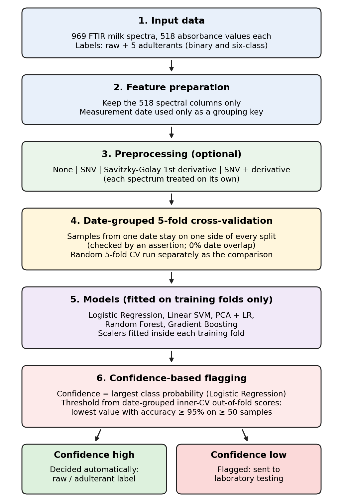

# Leakage-Aware Detection of Milk Adulteration from FTIR Spectra

Reproducibility materials for the paper **“Leakage-Aware Detection of Milk Adulteration from Infrared Spectra with Confidence-Based Flagging.”**

The project compares random and measurement-date-grouped cross-validation on a public subset of FTIR milk spectra, tests spectral preprocessing, and evaluates confidence-based flagging for samples that should be referred for laboratory testing.



## Repository structure

- `code/` — experiment scripts.
- `figures/` — paper figures used independently of individual runs.
- `results/protocols_seed42/`, `results/protocols_seed1/`, `results/protocols_seed2/` — outputs from the main protocol script for seeds 42, 1, and 2.
- `results/confidence_grouped/` — outputs from the earlier grouped-CV confidence experiment.
- `results/extra_experiments/` — available per-seed and summary outputs for the leakage and preprocessing experiments.
- `13040_2019_200_MOESM2_ESM.csv` — included copy of the public supplementary dataset.
- `DATA_SOURCE.txt` — dataset provenance and licensing notes.
- `research_log.md` — experiment history, verification notes, and remaining work.

## Dataset

The included CSV is the supplementary dataset associated with H. A. Neto et al., “On the utilization of deep and ensemble learning to detect milk adulteration,” *BioData Mining*, 2019, DOI: [10.1186/s13040-019-0200-5](https://doi.org/10.1186/s13040-019-0200-5).

The file contains 969 spectra, 518 spectral feature columns, six classes, and measurement-date metadata. Only spectral columns are model features. Metadata and laboratory composition columns are excluded from the feature matrix. See `DATA_SOURCE.txt` for attribution and licence details.

## Environment and setup

The original run log records Python 3.14.2, scikit-learn 1.9.1, NumPy 2.5.4, pandas 3.1.0, Windows 11, an Intel Core i5-1340P, and 16 GB RAM. No GPU was used.

Create and activate a virtual environment, then install dependencies:

```bash
python -m venv .venv
```

Windows PowerShell:

```powershell
.venv\Scripts\Activate.ps1
```

macOS/Linux:

```bash
source .venv/bin/activate
```

Install packages:

```bash
python -m pip install -r requirements.txt
```

## Reproducing experiments

Run commands from the repository root.

| Experiment | Command | Related paper content |
|---|---|---|
| Main protocols, seed 42 | `python code/milk_adulteration_ml.py --csv 13040_2019_200_MOESM2_ESM.csv --seed 42 --out results/protocols_seed42` | Table X; seed-42 diagnostics |
| Main protocols, seed 1 | `python code/milk_adulteration_ml.py --csv 13040_2019_200_MOESM2_ESM.csv --seed 1 --out results/protocols_seed1` | Table X |
| Main protocols, seed 2 | `python code/milk_adulteration_ml.py --csv 13040_2019_200_MOESM2_ESM.csv --seed 2 --out results/protocols_seed2` | Table X |
| Earlier grouped confidence experiment | `python code/milk_confidence_grouped.py --csv 13040_2019_200_MOESM2_ESM.csv --out results/confidence_grouped` | Earlier confidence experiment / Fig. 4 |
| Extra experiments | `python code/milk_extra_experiments.py --csv 13040_2019_200_MOESM2_ESM.csv --seeds 42 1 2 --out results/extra_experiments` | Tables IX, XI, XII and related figures |

The commands above describe the scripts' intended outputs. **The original Exp 1–3 outputs (`exp1_per_seed.csv`, `exp1_summary.csv`, `exp2_per_seed.csv`, `exp2_summary.csv`, `exp3_per_seed.csv`, `exp3_summary.csv`) and `run_log_extra.txt` are now included in `results/extra_experiments/`. The summaries support the rounded values reported in Tables IX–XII. This is a file-level consistency check, not a fresh end-to-end rerun; rerun the script in the intended environment before claiming computational reproducibility.

## Interpreting results

- The study compares random cross-validation with cross-validation grouped by measurement date. The reported date-overlap share is 86.3% for random five-fold CV and 0% for date-grouped CV.
- Date and batch coincide in this dataset, so the experiment cannot isolate a date effect from a batch effect.
- Random Forest is labelled “Proposed” in some legacy output files. This is a historical label, not a claim that Random Forest is the proposed contribution. The paper describes the contribution as a leakage-aware evaluation and confidence-based triage workflow.
- The model and preprocessing comparisons are exploratory, and the data are a 969-sample subset from one source/instrument. Results should not be read as proof of generalisation to real market samples or other laboratories.
- The workflow is a screening aid only. Uncertain samples should be sent for confirmatory chemical analysis; model output should not be the sole basis for regulatory or legal decisions.

## AI assistance

The paper and project documentation state that Claude (Anthropic) assisted with code writing/debugging, experiment suggestions, and drafting. Keep this declaration only if it accurately reflects the work and review performed by the authors. The authors should personally verify the final code, results, citations, and paper wording before submission.

## Citation

Please cite Neto et al. (2019), DOI [10.1186/s13040-019-0200-5](https://doi.org/10.1186/s13040-019-0200-5), when reusing the dataset. Cite the paper and other sources listed in the manuscript as appropriate.
